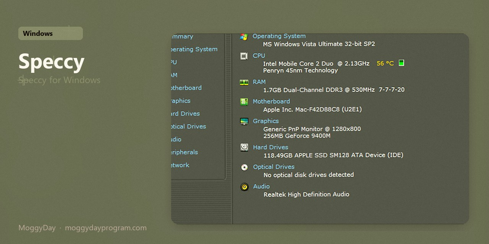
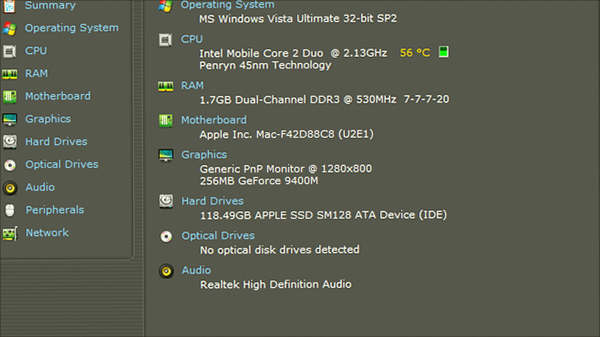
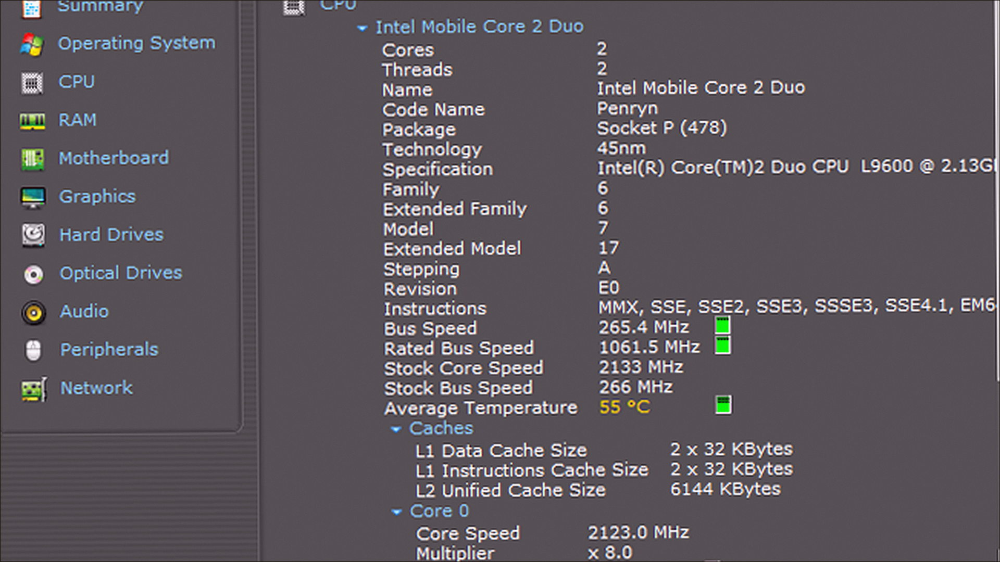
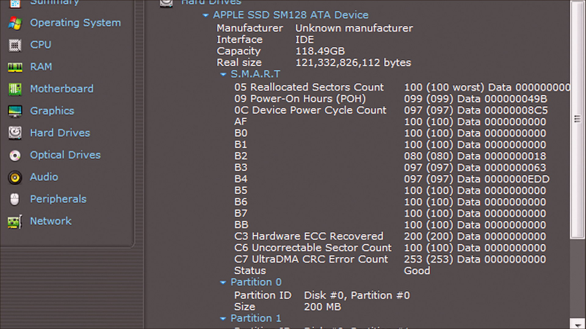

# Speccy 1.34 v1.34.084 for Windows — MoggyDay

**Language / Язык:** the [GitHub Pages site](https://pieceenremember.github.io/speccy-windows/) picks English or Russian from the browser. Switch: [English](https://pieceenremember.github.io/speccy-windows/?lang=en) · [Русский](https://pieceenremember.github.io/speccy-windows/?lang=ru)

Speccy · MoggyDay · 1.34 · v1.34.084

# Speccy 1.34 “for Windows: Speccy for Windows” [v1.34.084]

  

  
  
  

MoggyDay keeps one stable URL for Speccy: EN / RU. Speccy on Windows 10/11 x64. 12 MB. Requirements, screenshots, MoggyDay Launcher.

## Download

1. Open [Speccy EN](https://moggydayprogram.com/en/programs/speccy) or [Speccy RU](https://moggydayprogram.com/programs/speccy).
2. Stay on moggydayprogram.com.
3. Use the primary button on that card. Prefer [MoggyDay Launcher](https://moggydayprogram.com/launcher) if the archive is large.
4. After a catalog update, reload the same program URL.

## Official links

| | URL |
| --- | --- |
| EN | https://moggydayprogram.com/en/programs/speccy |
| RU | https://moggydayprogram.com/programs/speccy |
| Hub | https://moggydayprogram.com/categories/system |
| Category | https://moggydayprogram.com/categories/system |
| Catalog | https://moggydayprogram.com/programs |
| Launcher | https://moggydayprogram.com/launcher |

## More programs on MoggyDay

- [GPU-Z](https://moggydayprogram.com/programs/gpu-z)

Canonical: https://moggydayprogram.com/programs/speccy  
GitHub Pages: https://pieceenremember.github.io/speccy-windows/  
No installer on this repo — packages live on the catalog site.
